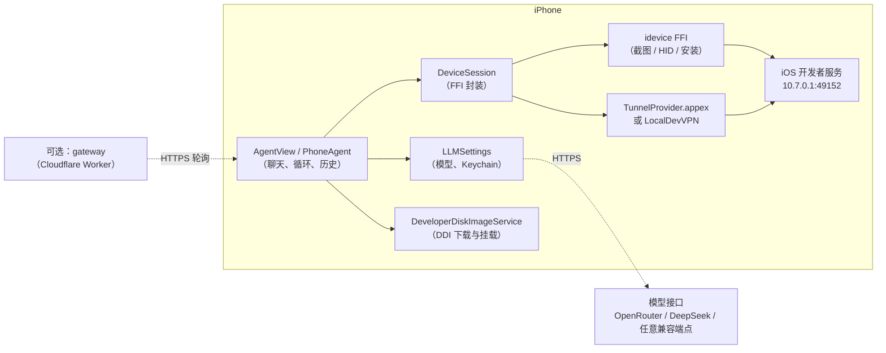

# 架构说明 · Architecture

> **English summary** — The app is a single SwiftUI target plus two extensions. It reaches *its own* iPhone's
> developer services through a loopback VPN (`TunnelProvider` or LocalDevVPN) and an Ed25519 RP pairing file,
> talking to the device over a Rust FFI (`idevice`). The agent loop is: screenshot → chat completion with tool
> calls → HID/`open_app` action → repeat. A developer disk image (DDI) must be mounted before screenshots work.
> An optional Cloudflare Worker gateway can dispatch tasks from a desktop; it is off by default.
> Details below are in Chinese.

## 目标与约束

- **运行时不依赖电脑**：智能体、隧道、注入都在手机上完成。
- **只用公开可得的系统能力**：开发者模式 + 开发者服务（CoreDevice / Remote Pairing）+ 回环 VPN。
  不越狱、不注入第三方 dylib。
- **只能侧载**：依赖开发者服务，无法通过 App Store 审核。
- **随时可能失效**：底层是私有协议，Apple 一次更新就可能改掉。

## 组件图



## 连接流程

`iPhoneUse/Device/Connection.swift` 的顺序是固定的：

1. **起 VPN**：`VPNMode.builtIn` 用自带的 `TunnelProvider`；失败（免费账号没有 Network Extension 权限）时
   自动切到 `.localDevVPN`，并提示用户安装 App Store 的 LocalDevVPN。
2. **找配对服务**：Bonjour 浏览 `_remotepairing._tcp`，找不到则回退到 `10.7.0.1:49152`。
3. **建隧道**：读配对文件（`Documents/pairingFile.plist`），调 `tunnel_create_rppairing(hostname:)`。
   握手用 pairing 文件里的 Ed25519 密钥做 TLS-PSK 验证。
4. **准备 DDI**：iOS 26.4+ 用 cryptex 方式，需要 5 个文件；下载完成（或文件已就位）后才继续。
5. **挂载 DDI**：挂载成功后才能截图与注入。
6. **就绪**：状态显示「已连接」，聊天页可以下发任务。

任何一步失败都会把原因写回聊天界面；日志追加到 `Documents/idevice_log.txt`。

## 智能体循环

`iPhoneUse/Agent/PhoneAgent.swift`：

```
启动 → 读取 App 列表 → system prompt + "Task: …"
  ↺ 截图（缩放到 imageWidth，JPEG 0.7）→ 只保留最近 2 张图
     → POST /chat/completions（tools + tool_choice=auto，max_tokens 1024）
     → 解析 tool_calls[0] → 执行 → 记录一步 → 下一张截图
done → 返回 summary（Markdown）
```

工具集合：

| 工具 | 作用 | 备注 |
|---|---|---|
| `tap(x, y)` | 点按 | 坐标是截图像素，内部归一化到 0…65535 |
| `swipe(x1, y1, x2, y2)` | 滑动 | 同上 |
| `long_press(x, y)` | 长按 | 用于唤出输入框菜单，点「粘贴」 |
| `type(text)` | 打字 | 只接受 ASCII；中文走拼音 |
| `home` | 回主屏 | |
| `open_app(bundle_id)` | 打开 App | 优先用，比在桌面上找图标稳 |
| `ask_user_question(q)` | 问用户 | 需要密码、验证码时用 |
| `done(summary)` | 结束 | summary 会按 Markdown 渲染 |

模型必须同时支持**图片输入**与**函数调用**，否则第一步就会失败。

## 中文输入

`type` 走 HID 键盘，只能打 US 布局的 ASCII；非 ASCII 字符会被丢弃。
尝试过「写剪贴板 + HID ⌘V」，实测 iOS 在后台写剪贴板不落地（系统限制），已废弃。

现行方案：模型输出拼音（`wo yao cha tian qi`），再在下一张截图里点候选栏选字；
选不出时用 `long_press` 长按输入框、点「粘贴」；再不行就用 `ask_user_question` 请用户自己补。

## DDI（开发者磁盘映像）

`iPhoneUse/Device/DeveloperDiskImageService.swift` + `DDIDownloadCenter.swift`：

- iOS > 26 或 26.4+ 走 **cryptex**：需要 `BuildManifest.plist`、`Image.dmg`、`Image.dmg.trustcache`、
  `Image.dmg.cryptex_info`、`Image.dmg.root_hash` 五个文件。
- 下载按优先级逐个尝试：GitHub raw → `raw.githubusercontent.com` → `ghfast.top` → `gh-proxy.com`，
  每个源的失败原因都会显示在进度卡上。
- 如果文件已经放在 `Documents/DDI/`，App 直接认领（写 `MountMethod`），不再联网。
- 进度：`DDIDownloadCenter` 是 `@MainActor @Observable` 单例，`DDIProgressCard` 在聊天页与设置页共用同一张卡。

## 远程网关（可选）

`gateway/`（Cloudflare Worker）+ `iPhoneUse/Agent/RemoteGateway.swift`：

- 默认关闭，必须自己部署并配置 `DEVICE_TOKEN`（设备）与 `AGENT_KEYS`（调用方白名单）。
- 手机侧主动轮询，**前台才接收**，收到后默认需要用户批准；自动执行是显式开启的高风险选项。
- 信任边界：网关只是转发，不持有模型 Key，也不存截图；截图只在手机上。

## 构建

- `scripts/build-idevice.sh`：clone `jkcoxson/idevice`、打补丁（`idevice-patch/`）、交叉编译
  `aarch64-apple-ios`，产出 `iPhoneUse/idevice/libidevice_ffi.a`（约 45 MB，已被忽略）。
- `xcodebuild` 以 `CODE_SIGNING_ALLOWED=NO` 出未签名 `.app`，CI 里打包成 IPA。
- CI 固定 `xcode-27` runner：Xcode 26.6 的 Swift 前端会在 `AgentView.swift` 的输入框表达式上超时。

## 关键文件

| 文件 | 职责 |
|---|---|
| `iPhoneUse/Agent/PhoneAgent.swift` | 智能体循环、工具定义与执行 |
| `iPhoneUse/Agent/LLMSettings.swift` | 端点、模型、Keychain Key、系统提示词 |
| `iPhoneUse/Device/Connection.swift` | 连接状态机、VPN 模式、错误文案 |
| `iPhoneUse/Device/DeviceSession.swift` | 隧道、端口发现、日志 |
| `iPhoneUse/Device/DeviceSession+Services.swift` | 截图、点击、滑动、输入 |
| `iPhoneUse/Device/DeveloperDiskImageService.swift` | DDI 下载与挂载 |
| `iPhoneUse/Support/MarkdownText.swift` | Markdown 渲染与公式 |
| `iPhoneUse/Support/GlassStyle.swift` | 液态玻璃样式基建 |
| `idevice-patch/probe.rs` | FFI 侧的新增能力（长按、粘贴等） |
| `gateway/src/index.ts` | Worker：任务投递、批准、轮询 |
